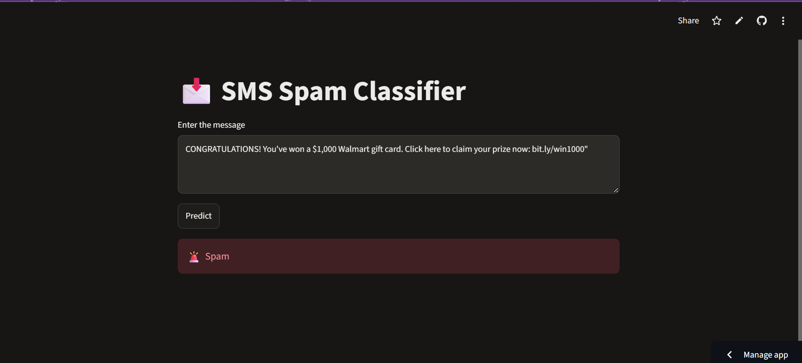

# 📩 SMS Spam Classifier

A machine learning web app that classifies SMS messages as **Spam** or **Not Spam**, built with Python, scikit-learn, NLTK, and deployed using Streamlit.



## 🛠️ Tech Stack
- Python
- Scikit-learn (Naive Bayes / classification model)
- NLTK (text preprocessing: tokenization, stopword removal, stemming)
- TF-IDF Vectorizer
- Streamlit (web UI + deployment)

## 📋 How It Works
1. User enters an SMS/message in the text box
2. Text is preprocessed: lowercased, tokenized, stopwords and punctuation removed, words stemmed
3. Preprocessed text is converted into numerical features using a pre-trained TF-IDF vectorizer
4. The trained model predicts whether the message is Spam or Not Spam

## 📂 Project Structure
```
├── app.py                 # Streamlit app
├── model.pkl              # Trained classification model
├── vectorizer.pkl         # TF-IDF vectorizer
├── requirements.txt       # Python dependencies
└── README.md
```

## 💻 Running Locally
```bash
pip install -r requirements.txt
streamlit run app.py
```

## ⚠️ Limitations
- **Trained on an older dataset**: The model was trained on the classic SMS Spam Collection dataset, which reflects spam patterns from that era (e.g. "WIN a free prize", "URGENT call now"). It does not include modern scam patterns like cryptocurrency investment scams, phishing links, or social-engineering messages referencing platforms like LinkedIn.
- **Vocabulary limitation (TF-IDF)**: The vectorizer only recognizes words it saw during training. Newer scam-related terms (e.g. "Bitcoin", "invest", "crypto") may be treated as neutral/normal words since they weren't part of the original training vocabulary, leading to false negatives (spam misclassified as not spam).
- **No context/semantic understanding**: The model relies on word frequency patterns (bag-of-words style features) rather than true language understanding, so cleverly worded or paraphrased spam may bypass detection.
- **Binary classification only**: The model outputs Spam/Not Spam only — no confidence score, no sub-categories (e.g. phishing vs. promotional vs. scam).
- **English-only**: Preprocessing and stopword removal are English-specific.

## 🔮 Future Improvements
- Retrain on a more recent, diverse dataset covering modern scam typologies
- Add feature engineering for patterns like currency symbols, URLs, and urgency phrases
- Experiment with more context-aware models (e.g. transformer-based embeddings)
